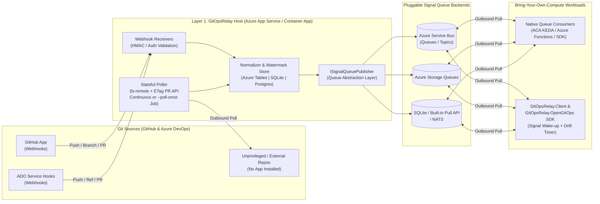

# Open-Source Project Plan: GitOpsRelay (`jacobmsft/GitOpsRelay`)

> **Project Name:** `GitOpsRelay`  
> **Target Repository & License:** `github.com/jacobmsft/GitOpsRelay` — **MIT License**  
> **Primary Stack:** C# / .NET 10 (`.slnx`, ASP.NET Core Minimal APIs, pluggable Queue & State providers, Worker SDK NuGet packages)  
> **Deployment Targets:** **Azure App Service**, **Azure Container Apps** (Web + Jobs), Docker/Kubernetes, or standalone binary

---

## 1. Vision & Problem Statement

Modern engineering organizations split source control across **GitHub** and **Azure DevOps** (cloud and self-hosted), yet face three recurring friction points when automating workflows or GitOps deployments:

1. **SCM Coupling:** Every downstream workload has to parse incompatible GitHub App and Azure DevOps Service Hook payloads, signatures, and auth models.
2. **Unprivileged Repositories:** Teams often depend on upstream, partner, or locked-down enterprise repositories where they **cannot install a GitHub App or ADO Service Hook**.
3. **Network & Firewall Boundaries:** Private clusters, air-gapped environments, and developer/runner nodes shouldn't expose public inbound webhook endpoints just to react to Git changes.

**`GitOpsRelay`** solves all three with a two-layer open-source platform:

- **Layer 1 — Universal Git Signal Bus (Core Platform):** Ingests GitHub App webhooks and Azure DevOps Service Hooks where permitted, falls back to (or pairs with) **stateful Git & API polling** where apps cannot be installed, normalizes every change into an identical **CloudEvents 1.0** `GitSignal`, and emits it through a **pluggable Queue Abstraction Layer** (such as **Azure Storage Queues**, **Azure Service Bus**, SQLite, or NATS) so any external workload can pull and run on its own compute.
- **Layer 2 — OpenGitOps Reconciler SDK (Optional Library):** A lightweight .NET library built on the Layer 1 Consumer SDK that turns instant queue wake-ups + periodic drift checks into a closed-loop **OpenGitOps v1.0.0** reconciler.

---

## 2. Architecture Overview



### How the Two Layers Map to OpenGitOps v1.0.0

| OpenGitOps Principle | Layer 1 (Core Signal Bus) | Layer 2 (`GitOpsRelay.OpenGitOps` SDK) |
| :--- | :--- | :--- |
| **1. Declarative** | Payload-agnostic; optionally filters on declarative manifest paths (`deploy/**`). | Typed desired-state loader bound to repository manifest paths. |
| **2. Versioned & Immutable** | Every signal pins exact `beforeSha` and `afterSha` commit hashes, never mutable branch names alone. | Reconciles strictly against immutable commit SHAs. |
| **3. Pulled Automatically** | Workloads **pull** signals from the queue (no inbound webhooks into target environments). | Automatically pulls desired state declarations on signal wake-up. |
| **4. Continuously Reconciled** | Hybrid webhook + audit polling heals missed SCM events. | Coalesces instant queue signals with a periodic **drift timer** and reports closed-loop reconciliation status. |

---

## 3. Core Subsystem Design

### 3.1 Canonical Signal Envelope (CloudEvents 1.0)

Every event—whether delivered by a GitHub App, an Azure DevOps Service Hook, or synthesized by the poller—produces the exact same JSON envelope conforming to **CloudEvents v1.0** (with optional **CDEvents** header/type mapping):

- **Normalized Event Types:**
  - `io.gitopsrelay.git.push`
  - `io.gitopsrelay.git.branch.created` / `io.gitopsrelay.git.branch.deleted`
  - `io.gitopsrelay.git.tag.created` / `io.gitopsrelay.git.tag.deleted`
  - `io.gitopsrelay.git.pr.opened` / `io.gitopsrelay.git.pr.updated` / `io.gitopsrelay.git.pr.merged` / `io.gitopsrelay.git.pr.closed`
- **Key Payload Fields (`data`):**
  - `repository`: `{ provider: "github" | "azdo" | "git", host, owner, project?, name, cloneUrl (userinfo-stripped), defaultBranch, canonicalId (lowercase host/path NFC) }`
  - `ingestion`: `{ mode: "webhook" | "poll", observedAt, rawDeliveryId? }`
  - `change`: `{ ref, refType: "branch" | "tag", beforeSha, afterSha, isForcePush?: boolean | null, changedPaths?: string[], actor? }`
  - `pullRequest?`: `{ id, number, title, status, isDraft, sourceRef, targetRef, headSha, mergeCommitSha? }`
- **CloudEvents Extensibility:** Sets `subject` to the normalized ref/PR identifier and permits standard CloudEvents extension attributes (such as OpenTelemetry `traceparent` and `dataschema`).

### 3.2 Webhook-to-Polling Parity & Deduplication Engine

Simulating identical signals when an app cannot be installed requires a **two-tier poller** backed by a persistent **Ref Snapshot & Watermark Store**:

1. **Tier 1 — Zero-API-Quota Ref Poller (`git ls-remote` over Smart HTTP / SSH):**
   - Queries ref advertisements (`refs/heads/*`, `refs/tags/*`) without cloning the repo and **without burning GitHub/ADO REST API rate limits**, ignoring peeled annotated-tag dereference entries (`refs/tags/*^{}`) so unpeeled tag OIDs match webhooks.
   - Normalizes all-zero 40/64-char webhook OIDs (`0000...`) to `null` so webhook and poll transitions classify identically, and supports **silent initial baseline seeding** when a repository is first registered (avoiding thousands of synthetic `created` signals on existing tags/branches).
   - Diffs against the stored `(repo_id, ref_name) -> sha` map:
     - `null -> sha` emits `git.branch.created` (or `git.tag.created`) + `git.push`.
     - `old_sha -> new_sha` emits `git.push` with exact `beforeSha` and `afterSha`.
     - `old_sha -> null` emits `git.branch.deleted` (or `git.tag.deleted`).
   - **Lazy Path Enrichment:** Only if an active subscription filters on `pathGlobs` (e.g., `infra/**`), the normalizer resolves `changedPaths` via the SCM Compare API or a blobless shallow fetch (`git fetch --filter=blob:none`).
2. **Tier 2 — Conditional PR Metadata Poller (GitHub & ADO REST):**
   - Git refs alone don't carry PR state (draft, opened, merged vs. direct push).
   - Uses `If-None-Match` (ETag) on GitHub (`304 Not Modified` costs **0 rate-limit points**) and continuation/updated-after watermarks on ADO to synthesize `git.pr.*` signals with full parity.
3. **Compare-and-Swap Ref Snapshots, Short-Window Dedup & Hybrid Mode:**
   - **CAS Snapshot as Primary Truth:** Both webhook handlers and poll cycles advance per-ref state via optimistic concurrency (`ETag` / version token), and only commit watermarks/dedup entries **after** queue publish succeeds (reserve/commit/abandon) so crashes never drop signals.
   - **ABA-Safe Short Dedup Window:** Deterministic transition keys (`v1` length-prefixed hash over canonical repo ID, event type, ref, `beforeSha`, `afterSha`) use a short broker/store dedup window (~poll interval rather than multi-day retention) so legitimate rollback + roll-forward (`A→B→A→B`) transitions are never suppressed.
   - **Bonus superpower ("Hybrid Mode"):** Even on repos *with* a GitHub/ADO App installed, running a slow background poll (e.g., every 15m) against the shared CAS ref snapshot acts as a self-healing audit loop—catching up any dropped webhooks without spurious `A→C` duplicates.

### 3.3 Pluggable Queue Abstraction Layer (`ISignalQueuePublisher` & `ISignalQueueConsumer`)

Rather than locking workloads into a proprietary broker, `GitOpsRelay` separates **signal normalization** from **queue transport** behind clean provider interfaces:

- **`ISignalQueuePublisher` (Emission Side):**
  - Emits canonical CloudEvents 1.0 `GitSignal` payloads (`application/cloudevents+json`, batch-capable, with ordering/partition key `canonicalId + ref`, routing target, and promoted metadata attributes `provider`, `repo`, `eventType`, `ref`, `idempotencyKey`) to one or more configured queue backends:
    1. **Azure Service Bus (`GitOpsRelay.Queues.AzureServiceBus`):** Publishes to a Queue or Topic; promotes CloudEvents attributes to Service Bus `ApplicationProperties` so workloads can use native Service Bus Topic Subscription SQL/Correlation filters, Dead-Letter Queues, Session ordering, and short-window `MessageId` deduplication.
    2. **Azure Storage Queues (`GitOpsRelay.Queues.AzureStorageQueues`):** Ultra-low-cost, zero-idle-cost queue emission; supports topic/route fan-out by mapping logical channels/subscriptions to named Storage Queues (with claim-check pointer support if `changedPaths` exceeds 64 KB).
    3. **Embedded SQLite / HTTP+gRPC Pull Queue (`GitOpsRelay.Queues.Sqlite`):** Zero-cloud-dependency local/self-hosted queue with built-in `/v1/subscriptions/{name}/lease` endpoints for local dev or non-Azure environments.
    4. **Extensible Community Providers:** NATS JetStream, PostgreSQL, RabbitMQ, or AWS SQS via the same `ISignalQueuePublisher` contract.
- **Dual Consumption Model (BYO Compute):**
  - **Via `GitOpsRelay.Client` SDK (`ISignalQueueConsumer`):** Portable .NET Worker SDK (`AddGitOpsRelayConsumer`) supporting lease renewal, explicit `Complete`/`Abandon` (with retry delay)/`DeadLetter`, delivery count inspection, and poison-message isolation across Azure Service Bus, Azure Storage Queues, or the built-in HTTP/gRPC endpoint.
  - **Direct Native Platform Consumption:** Because every emitted message is standard CloudEvents 1.0 JSON, workloads can also trigger directly via **Azure Container Apps KEDA scalers**, **Azure Functions Queue/ServiceBus triggers**, Logic Apps, or any language's native Azure SDK without needing a special client.

### 3.4 Cloud-Native Hosting: Azure App Service & Azure Container Apps

The entire server ships as a single, stateless-friendly ASP.NET Core host (`GitOpsRelay.Server`) engineered specifically to run cleanly on **Azure App Service** and **Azure Container Apps (ACA)**:

1. **Ephemeral-Disk Safe State (`IRefSnapshotStore`):**
   - App Service scale-out and Container Apps replicas cannot rely on local SQLite files for polling watermarks.
   - Ships **`GitOpsRelay.Storage.AzureTables`** (Azure Table Storage — shares the exact same Storage Account as Azure Storage Queues!) alongside SQLite (local dev) and PostgreSQL, using optimistic concurrency (`ETag`) and distributed lease locking (Blob/Table lease) so multiple replicas never double-poll the same repo.
2. **Flexible Polling Execution Modes:**
   - **Azure App Service Mode (`Always On`):** Runs webhook endpoints + the `BackgroundService` polling scheduler inside one Web App deployment (`azd deploy` / zip deploy / container).
   - **Azure Container Apps Mode:** Supports either a single continuously running Container App (`minReplicas: 1`) OR split **scale-to-zero HTTP webhook ingress (`minReplicas: 0`)** paired with a scheduled **ACA Job (`--poll-once`)** that wakes on a cron schedule, diffs refs, emits signals to Azure Queue/Service Bus, and exits cleanly.
3. **Passwordless Azure Auth (`DefaultAzureCredential`):**
   - First-class **Managed Identity** support for Azure Storage Queues, Azure Table Storage, Azure Service Bus, and Azure Key Vault (storing GitHub App private keys / ADO credentials).
4. **Turnkey Infrastructure-as-Code (`infra/`):**
   - Includes Bicep modules + `azure.yaml` (`azd up`) with a toggle between **Azure Container Apps** and **Azure App Service** hosting profiles.

### 3.5 Layer 2: `GitOpsRelay.OpenGitOps` Reconciler SDK

A separate, opt-in NuGet package built purely as a consumer of Layer 1:

- Exposes `IGitStateReconciler<TState>`:
  - Coalesces rapid bursts of `git.push` signals on the target ref so only the **latest desired commit SHA** is reconciled.
  - Runs a configurable **periodic drift timer** (e.g., every 5m) even when zero Git events occur, re-evaluating live state against the last known desired SHA.
  - Provides authenticated read-only artifact/manifest fetchers and an `IReconciliationReporter` interface to record drift/sync outcomes (OpenTelemetry metrics + optional GitHub Check Run / ADO Commit Status callback).

---

## 4. Proposed .NET Repository & Solution Layout

Follows modern .NET conventions (`.slnx`, `Directory.Build.props`, central package management via `Directory.Packages.props`):

```text
GitOpsRelay/
├── Directory.Build.props
├── Directory.Packages.props
├── GitOpsRelay.slnx
├── Dockerfile                                # Multi-stage rootless image for Azure Container Apps / App Service
├── azure.yaml                                # Azure Developer CLI (`azd up`) entry point
├── infra/                                    # Bicep templates (ACA or App Service + Storage Queue/Tables or Service Bus)
├── docs/
│   ├── adr/
│   │   ├── 0001-layered-signal-bus-and-opengitops.md
│   │   ├── 0002-webhook-polling-unification.md
│   │   └── 0003-pluggable-queues-and-azure-hosting.md
│   └── schema/
│       └── gitsignal.cloudevents.schema.json
├── src/
│   ├── GitOpsRelay.Contracts/                # CloudEvents models, filter AST, DTOs (zero heavy deps)
│   ├── GitOpsRelay.Core/                     # Normalizer, ref-diff engine, ISignalQueuePublisher/Consumer, IRefSnapshotStore
│   ├── GitOpsRelay.Providers.GitHub/         # GitHub App webhooks (HMAC, JWT/installation tokens) + ETag PR poller
│   ├── GitOpsRelay.Providers.AzureDevOps/    # ADO Service Hooks + REST PR/ref poller
│   ├── GitOpsRelay.Polling.Git/              # Smart-HTTP/SSH ls-remote poller (continuous BackgroundService + --poll-once mode)
│   ├── GitOpsRelay.Queues.AzureStorage/      # Azure Storage Queues publisher + consumer (Managed Identity ready)
│   ├── GitOpsRelay.Queues.AzureServiceBus/   # Azure Service Bus Queue/Topic publisher + consumer
│   ├── GitOpsRelay.Queues.Sqlite/            # Local/self-hosted SQLite queue + HTTP/gRPC pull adapter
│   ├── GitOpsRelay.Storage.AzureTables/      # Stateless-host Ref Snapshot & Watermark store on Azure Table/Blob leases
│   ├── GitOpsRelay.Storage.Sqlite/           # Local dev SQLite Ref Snapshot & Watermark store
│   ├── GitOpsRelay.Server/                   # Deployable ASP.NET Core host (App Service & Container Apps ready, healthz, OTel)
│   ├── GitOpsRelay.Cli/                      # `gitopsrelay` CLI (config check, `--poll-once`, replay)
│   ├── GitOpsRelay.Client/                   # Layer 1 Portable Workload Consumer SDK (`AddGitOpsRelayConsumer`)
│   └── GitOpsRelay.OpenGitOps/               # Layer 2 OpenGitOps Reconciler SDK (`AddOpenGitOpsReconciler`)
├── samples/
│   ├── Sample.EchoWorker/                    # Minimal Layer 1 consumer (works against Azure Queue, Service Bus, or local)
│   └── Sample.DeclarativeReconciler/         # Layer 2 OpenGitOps drift-healing worker
└── tests/
    ├── GitOpsRelay.Core.Tests/               # Ref-diff state machine & deduplication matrix
    ├── GitOpsRelay.Providers.Tests/          # Recorded GitHub & ADO webhook/poll parity fixtures
    └── GitOpsRelay.IntegrationTests/         # End-to-end tests (Azurite for Storage Queues/Tables + bare Git repos)
```

---

## 5. Security, Auth & Multi-Tenancy Guardrails

- **Inbound Webhook Verification:** Constant-time `X-Hub-Signature-256` HMAC verification for GitHub Apps; shared secret / Entra token verification for Azure DevOps Service Hooks.
- **Strict Credential Boundary:** SCM credentials (GitHub App private keys, installation tokens, ADO PATs / Managed Identities) live strictly inside the ingestion/polling host via pluggable `ISecretProvider` (Environment, Azure Key Vault, Kubernetes Secrets) and **never leak into `GitSignal` queue messages**.
- **Scoped Consumer Authorization:** Workloads authenticate to the Pull API with scoped bearer tokens / API keys bound to allowed `subscription` names and repository namespaces (preventing unauthorized repo snooping on shared buses).

---

## 6. Phased Open-Source Roadmap

### Phase 0 — Repository Bootstrap, Spec & Queue/State Abstractions (`v0.1.0-alpha`)
- Create `jacobmsft/GitOpsRelay` with MIT `LICENSE`, `README.md`, `CONTRIBUTING.md`, `SECURITY.md`, and GitHub Actions CI.
- Publish canonical `GitSignal` JSON Schema (CloudEvents 1.0) and ADRs (including ADR-0003 for pluggable Queue/State abstractions and App Service / Container Apps hosting).
- Scaffold `GitOpsRelay.slnx`, central package management, `GitOpsRelay.Contracts`, and `GitOpsRelay.Core` (`ISignalQueuePublisher`, `ISignalQueueConsumer`, `IRefSnapshotStore`, `IDistributedPollLeaseProvider`, ref-diff engine, and idempotency parity tests).

### Phase 1 — Walking Skeleton: GitHub + Poller + Azure Queue / Service Bus + Local SQLite (`v0.2.0`)
- Implement GitHub App webhook ingestion (`push`, `create`, `delete`, `pull_request`) + `GitOpsRelay.Polling.Git` (`ls-remote` continuous & `--poll-once` modes).
- Ship first-class queue providers: **`GitOpsRelay.Queues.AzureStorage`**, **`GitOpsRelay.Queues.AzureServiceBus`**, and **`GitOpsRelay.Queues.Sqlite`** (for local zero-dependency dev), plus **`GitOpsRelay.Storage.AzureTables`** for stateless App Service / ACA watermark persistence.
- Ship `GitOpsRelay.Server` (`Dockerfile` + App Service publish profile) and `GitOpsRelay.Client` SDK (`Sample.EchoWorker`), verified against Azurite in integration tests.

### Phase 2 — Azure DevOps Parity, PR Polling & Turnkey Azure Deployment (`v0.4.0`)
- Implement `GitOpsRelay.Providers.AzureDevOps` Service Hook receiver (`git.push`, `git.pullrequest.*`) + Tier 2 conditional PR API polling (GitHub ETag + ADO watermarks).
- Ship `infra/` Bicep templates + `azure.yaml` (`azd up`) supporting both **Azure Container Apps** (Web + optional ACA Job poller + KEDA) and **Azure App Service** with Managed Identity (`DefaultAzureCredential`).
- Add routing/filtering rules (`repo`, `event`, `ref` globs, lazy `changedPaths` globs) and `gitopsrelay` CLI.

### Phase 3 — Hybrid Self-Healing, Observability & Additional Brokers (`v0.6.0`)
- Enable **Hybrid Mode** (webhook primary + low-frequency background audit poll for guaranteed eventual completeness).
- Add OpenTelemetry metrics/traces (Application Insights / OTLP ready: ingestion lag, poll budget, queue publish latency) + optional Postgres/NATS community adapters.

### Phase 4 — Layer 2 OpenGitOps Reconciler SDK & `v1.0.0`
- Ship `GitOpsRelay.OpenGitOps` NuGet package: signal coalescing, periodic drift reconciliation loop, commit-SHA desired-state fetcher, and closed-loop status reporting back to GitHub Checks / ADO Commit Statuses.
- Publish full documentation site, quickstart `azd up` + Docker Compose demos, and `1.0.0` NuGet packages.

---

## 7. Implementation Notes for Phase 0

- **Repository:** `github.com/jacobmsft/GitOpsRelay` (MIT License)
- **Git Transport Strategy:** Pure-HTTP Git smart-protocol (`info/refs`) client for zero-dependency `ls-remote` ref polling, paired with a thin `git` CLI fallback for SSH remotes and blobless shallow `changedPaths` diffs.
